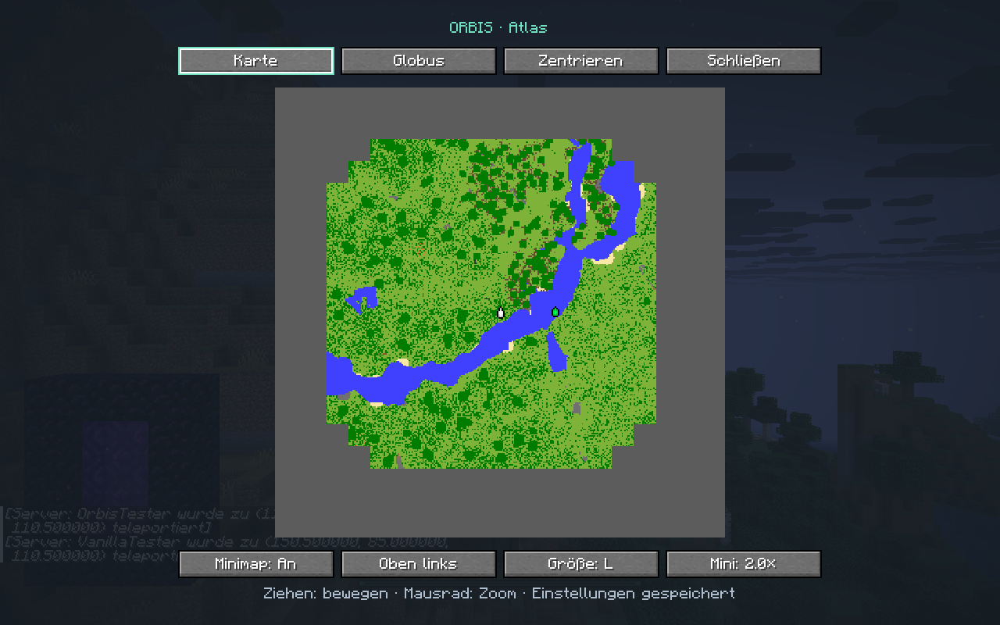
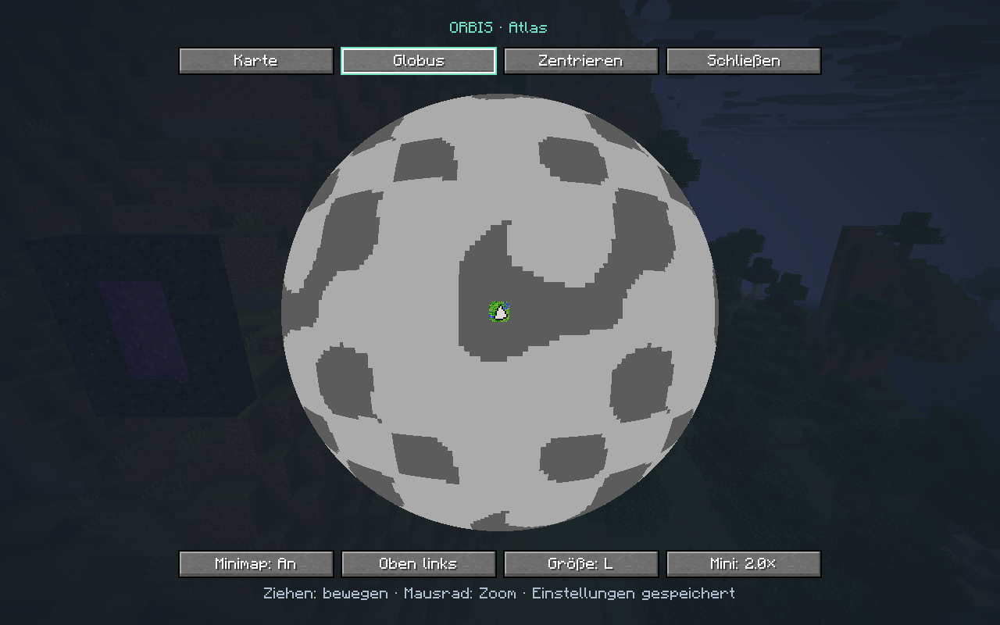
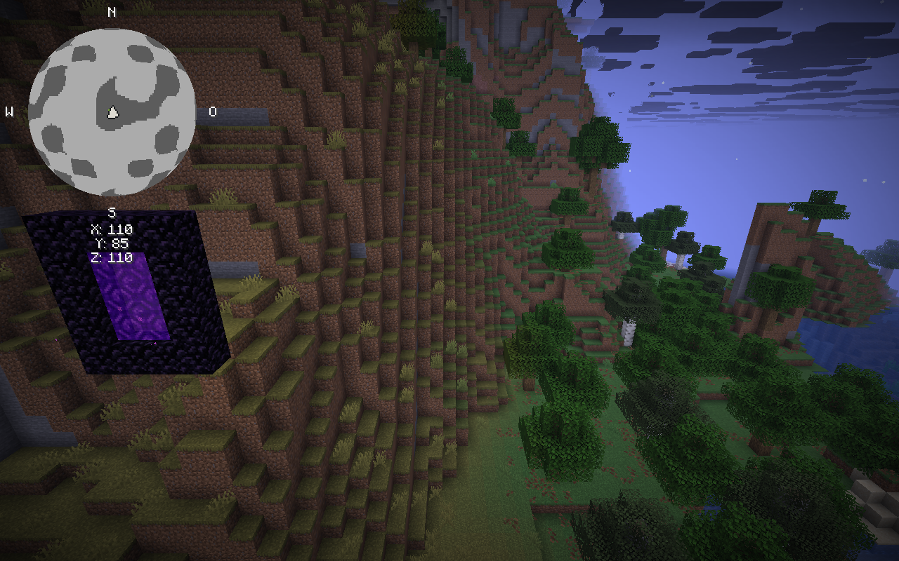

# Orbis

Finite Minecraft worlds. Seamless exploration.

Minecraft Java worlds span roughly 60 million × 60 million blocks, about 30 million from the centre in each direction. Think of [2b2t](https://www.2b2t.org/): a server running since 2010 whose world has welcomed over a million players. For one player or a small group, exploring a whole world that size is out of reach.

Orbis is built around a different idea: a world small enough to get to know. Discover its landscapes, find your favourite places, and gradually make the whole world familiar. Each seed gives you a different world to call home.

Choose a size and keep exploring. When you cross an edge, you continue on the opposite side of the same world.

## How Orbis works

Imagine a square map. Join its top and bottom edges to make a cylinder, then connect the two open ends to make a torus. Both pairs of opposite edges are now neighbours.

The shape explains how the edges connect. In Minecraft, the ground and gravity stay normal. Only the two horizontal directions wrap.

### East and west

Walk across the blue edge and continue on the opposite side. Keep going and you arrive back where you started.

### North and south

The gold edges connect in the same way. You can travel around the world in this direction too.

### Diagonally

Each direction wraps independently. Here, Steve crosses the gold edge first, then the blue edge, while continuing along the same diagonal.

## Features

Orbis is an early development alpha (current version **0.1.0-alpha.12**). The features below are implemented. Real Minecraft sessions on a local dedicated server covered all X/Z/corner seam crossings, save and restart, the unwrapped End, the player map and joins from both Orbis and vanilla clients ([test records](docs/IMPLEMENTATION.md#validation)). Broader gameplay and mod compatibility testing remains open. The animations above are illustrations.

- **A finite world without a wall.** The Overworld and Nether connect across both horizontal edges.
- **A size that suits your world.** Use the slider, choose Tiny, Small, Normal, Large or Earth, or enter an exact width. The world overview shows the area and dimension sizes before you apply them.
- **A connected Nether.** Its width is always exactly one eighth of the Overworld's, matching Minecraft's usual coordinate scale.
- **A familiar End.** The End keeps its normal, unwrapped behaviour.
- **A small player map.** A corner minimap and a map/globe view (press **M**) show the terrain you have seen and the other players in your dimension. Settings are saved. It works in singleplayer and on servers.
- **Server ready.** One JAR for server and players; players without Orbis are told which version to install. Operators can run `/orbis check` to look for the expected biomes and structures. See the [server and player guide](docs/SERVER.md).
- **Orbis cartography goals.** Three original advancements reward preparing a compass, map and field kit. See the [identity audit](docs/ORBIS_IDENTITY.md).

| Map | Globe | Minimap |
| --- | --- | --- |
|  |  |  |

Screenshots from the in-game verification runs (German client language).

## Compatibility

Orbis currently targets **Fabric**. Install Fabric Loader, Fabric API and the Orbis JAR. The current alpha targets Minecraft 26.3 and Java 25.

The following mods are priorities for compatibility testing. Their support in Orbis has **not yet been verified**.

<table>
  <tr>
    <td width="33%"><a href="https://modrinth.com/mod/fabric-api"> Fabric API</a></td>
    <td width="33%"><a href="https://modrinth.com/mod/distanthorizons"> Distant Horizons</a></td>
    <td width="33%"><a href="https://modrinth.com/mod/iris"> Iris Shaders</a></td>
  </tr>
  <tr>
    <td width="33%"><a href="https://modrinth.com/mod/sodium"> Sodium</a></td>
    <td width="33%"><a href="https://modrinth.com/mod/lithium"> Lithium</a></td>
    <td width="33%"><a href="https://modrinth.com/mod/ferrite-core"> FerriteCore</a></td>
  </tr>
  <tr>
    <td width="33%"><a href="https://modrinth.com/mod/entityculling"> Entity Culling</a></td>
    <td width="33%"><a href="https://modrinth.com/mod/modmenu"> Mod Menu</a></td>
    <td width="33%"><a href="https://modrinth.com/mod/litematica"> Litematica</a></td>
  </tr>
  <tr>
    <td width="33%"><a href="https://modrinth.com/mod/minihud"> MiniHUD</a></td>
    <td colspan="2"><a href="https://modrinth.com/mod/tweakeroo"> Tweakeroo</a></td>
  </tr>
</table>

Fabric API is a required dependency. The other mods are separate installations. Exact versions and test results belong in the [compatibility notes](docs/COMPATIBILITY.md).

## World sizes

Choose a preset or use the size slider and exact chunk input. New selections range from Tiny to Earth, in steps of 16 chunks. Each width is the full side length of the square world. Normal is the default. One chunk is 16 × 16 blocks; areas assume one block equals one metre.

| Size | Overworld chunks per side | Overworld blocks per side | Area (km², rounded) |
| --- | ---: | ---: | ---: |
| Tiny | 1,024 | 16,384 | 268 |
| Small | 8,832 | 141,312 | 19,969 |
| Normal | 76,544 | 1,224,704 | 1,499,900 |
| Large | 625,008 | 10,000,128 | 100,002,560 |
| Earth | 1,448,160 | 23,170,560 | 536,874,851 |

These are provisional sizes. Smaller worlds may miss biomes or structures; no preset currently guarantees them all. Earth is experimental: its target is 2²⁹ km², about 5.27% above Earth's roughly 510 million km² surface area. Preset widths are rounded to the nearest 16 chunks. The slider uses a logarithmic scale to keep smaller sizes easy to select. Existing smaller alpha saves remain readable.

## Not in this alpha

Orbis deliberately stays focused on the wrapping world, its sizes, the fixed 1:8 Nether and the small map. The following ideas are parked, not scheduled:

- **Converting existing worlds.** Start Orbis in a new world; it does not convert or resize existing saves.
- **A biome guarantee.** No preset guarantees every biome or structure. `/orbis check` reports what it could confirm.
- **Visual extras** such as a curved horizon or an exploration journal.

## Try the alpha

1. Install [Fabric Loader](https://fabricmc.net/use/) 0.19.5 or newer for Minecraft **26.3** (Java 25).
2. Put [Fabric API](https://modrinth.com/mod/fabric-api) 0.161.0+26.3 and `orbis-0.1.0-alpha.12.jar` in your `mods` folder. Do not install Toroidal World or Exotic Worlds alongside it.
3. Create a **new** world, set **World Shape: Orbis**, then **Customize** to choose the size.

Back up anything you care about; this is an alpha. Building from source, known limitations and the test records are in the [project guide](docs/IMPLEMENTATION.md). Server setup is in the [server and player guide](docs/SERVER.md); changes per version are in the [changelog](CHANGELOG.md).

## Inspiration and license

Orbis takes inspiration from [Toroidal World](https://modrinth.com/mod/toroidal-world) and [Circumnavigate](https://modrinth.com/mod/circumnavigate). Its world engine is compiled from a pinned Toroidal World source snapshot (commit `0600806`, MIT License). It ships as a standalone mod; no separate engine mod is needed.

Toroidal World has since been renamed Exotic Worlds and, from 9 October 2026, is published under the PolyForm Shield license. Orbis keeps using the MIT snapshot and does not copy code from the relicensed versions. Details are in [Sources and licensing](docs/SOURCES_AND_LICENSE.md).

Orbis is released under the [MIT License](LICENSE).
