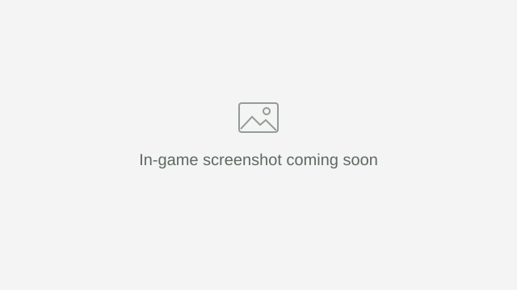

# Orbis

Finite Minecraft worlds. Seamless exploration.

Minecraft worlds are so vast that most of them will never be explored. Orbis is built around a different idea: a world small enough to get to know. Discover its landscapes, find your favourite places, and gradually make the whole world familiar. Each seed gives you a different world to call home.

Choose a size and keep exploring. When you cross an edge, you continue on the opposite side of the same world.

## How Orbis works

Imagine a square map. Join its top and bottom edges to make a cylinder, then connect the two open ends to make a torus. Both pairs of opposite edges are now neighbours.

The shape explains how the edges connect. In Minecraft, the ground and gravity stay normal. Only the two horizontal directions wrap.

### East and west

Walk across the blue edge and continue on the opposite side. Keep going and you arrive back where you started.

### North and south

The gold edges connect in the same way. You can travel around the world in this direction too.

### Diagonally

Each direction wraps independently. Here, Steve crosses the gold edge first, then the blue edge, while continuing along the same diagonal.

## Features

Orbis is an early development alpha. These features are implemented; in-game validation is still pending. The animations above are illustrations.

- **A finite world without a wall.** The Overworld and Nether connect across both horizontal edges.
- **A size that suits your world.** Choose one of five presets, try experimental Earth size, or set a custom width.
- **A connected Nether.** Its width stays eight times smaller than the Overworld, matching Minecraft's usual coordinate scale.
- **A familiar End.** The End keeps its normal, unwrapped behaviour.

<!-- Replace each placeholder with an in-game capture when available. -->

| Exploring across an edge | Choosing a world size | Travelling through the Nether |
| --- | --- | --- |
|  |  |  |

## Compatibility

Orbis currently targets **Fabric**. Install Fabric Loader, Fabric API and the Orbis JAR. The current alpha targets Minecraft 26.3 and Java 25.

The following mods are priorities for compatibility testing. Their support in Orbis has **not yet been verified**.

<table>
  <tr>
    <td width="33%"><a href="https://modrinth.com/mod/fabric-api"> Fabric API</a></td>
    <td width="33%"><a href="https://modrinth.com/mod/distanthorizons"> Distant Horizons</a></td>
    <td width="33%"><a href="https://modrinth.com/mod/iris"> Iris Shaders</a></td>
  </tr>
  <tr>
    <td width="33%"><a href="https://modrinth.com/mod/sodium"> Sodium</a></td>
    <td width="33%"><a href="https://modrinth.com/mod/lithium"> Lithium</a></td>
    <td width="33%"><a href="https://modrinth.com/mod/ferrite-core"> FerriteCore</a></td>
  </tr>
  <tr>
    <td width="33%"><a href="https://modrinth.com/mod/entityculling"> Entity Culling</a></td>
    <td width="33%"><a href="https://modrinth.com/mod/immediatelyfast"> ImmediatelyFast</a></td>
    <td width="33%"><a href="https://modrinth.com/mod/modmenu"> Mod Menu</a></td>
  </tr>
  <tr>
    <td width="33%"><a href="https://modrinth.com/mod/litematica"> Litematica</a></td>
    <td width="33%"><a href="https://modrinth.com/mod/minihud"> MiniHUD</a></td>
    <td width="33%"><a href="https://modrinth.com/mod/tweakeroo"> Tweakeroo</a></td>
  </tr>
</table>

Fabric API is a required dependency. The other mods are separate installations. Exact versions and test results belong in the [compatibility notes](docs/COMPATIBILITY.md).

## World sizes

A few examples from the current alpha presets. Each measurement is the full width of one side of the square world, in blocks.

| Size | Overworld | Nether |
| --- | ---: | ---: |
| Very small | 2,048 × 2,048 | 256 × 256 |
| Small | 4,096 × 4,096 | 512 × 512 |
| Medium / Normal | 16,384 × 16,384 | 2,048 × 2,048 |
| Large | 32,768 × 32,768 | 4,096 × 4,096 |
| Very large | 65,536 × 65,536 | 8,192 × 8,192 |

These are provisional sizes. Smaller worlds may miss biomes or structures; no preset currently guarantees them all. Earth is an additional experimental option with roughly the surface area of our planet, rather than a map of Earth.

## World conversion

Existing-world conversion is planned. The idea is to choose an area of a world you already play, keep your builds, and connect its opposite edges by regenerating and blending selected strips of terrain.

The conversion would work on a copy, with a preview of the affected areas before making changes. It is not available in the current alpha. A biome check for new worlds is also planned.

## Try the alpha

Use a new test world. Build and installation instructions, known limitations and development documentation are in the [project guide](https://github.com/TimoWey/Orbis/blob/orbis-alpha/docs/IMPLEMENTATION.md).

## Inspiration and license

Orbis takes inspiration from [Toroidal World](https://modrinth.com/mod/toroidal-world) and [Circumnavigate](https://modrinth.com/mod/circumnavigate). Its world engine comes from Toroidal World under the MIT License. It ships as a standalone mod; no separate Toroidal World installation is needed.

Orbis is released under the [MIT License](LICENSE). Upstream credits and source details are recorded in [Sources and licensing](docs/SOURCES_AND_LICENSE.md).
