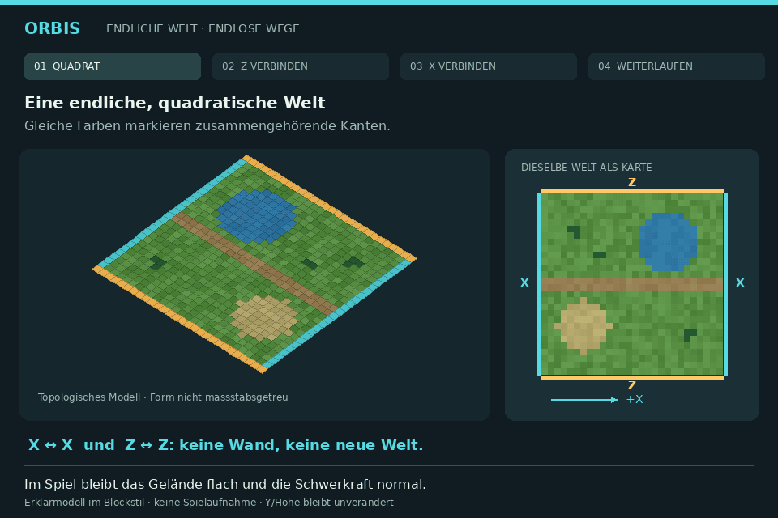
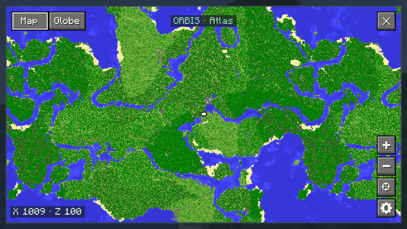
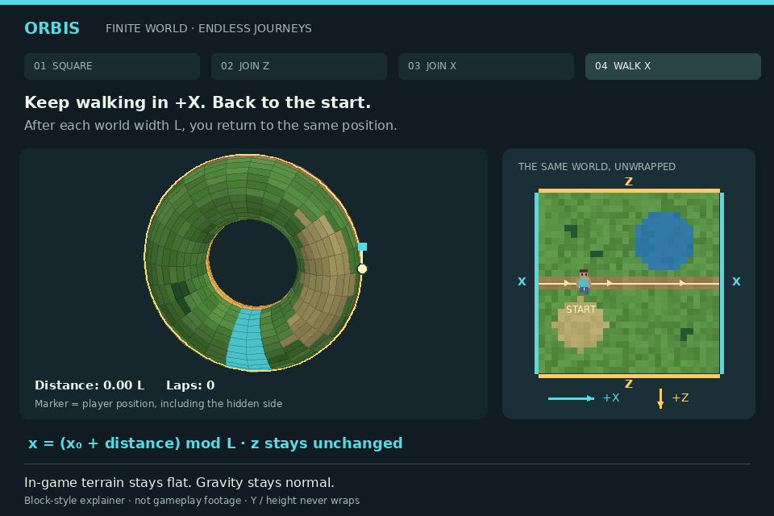
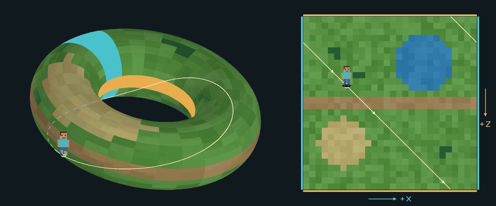
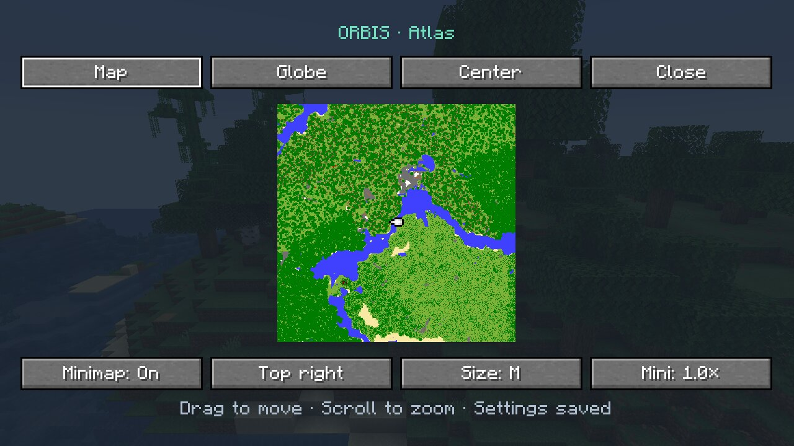
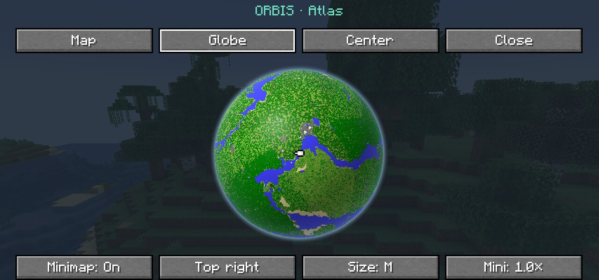
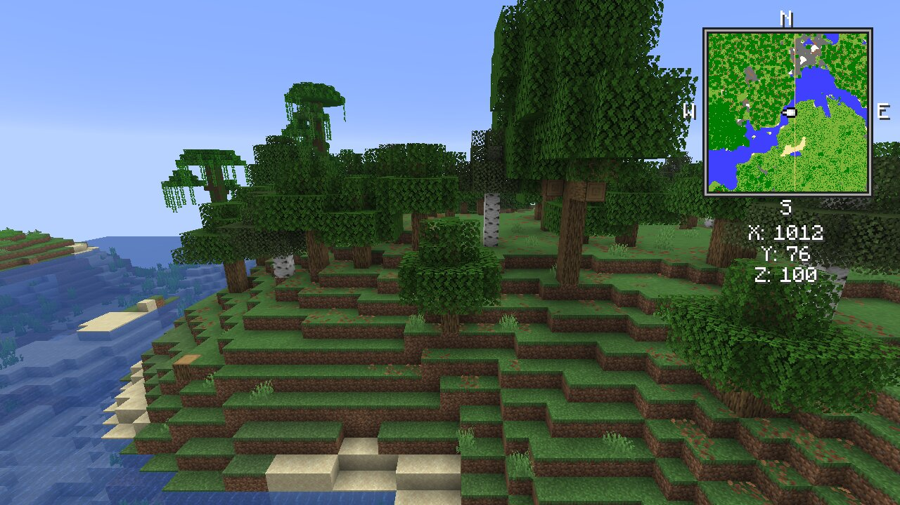

# Orbis

Finite Minecraft worlds. Seamless exploration.

**Download:** [Orbis on Modrinth](https://modrinth.com/mod/orbis-worlds) · Minecraft 26.3 · Fabric

Minecraft Java worlds span roughly 60 million × 60 million blocks, about 30 million from the centre in each direction. Think of [2b2t](https://www.2b2t.org/): a server running since 2010 whose world has welcomed over a million players. For one player or a small group, exploring a whole world that size is out of reach.

Orbis is built around a different idea: a world small enough to get to know. Discover its landscapes, find your favourite places, and gradually make the whole world familiar. Each seed gives you a different world to call home.

Choose a size and keep exploring. When you cross an edge, you continue on the opposite side of the same world.

## How Orbis works

Imagine a square map. Join its top and bottom edges to make a cylinder, then connect the two open ends to make a torus. Both pairs of opposite edges are now neighbours.

Orbis comes with its own map, the **Atlas**: a flat map and a globe that show how the edges connect.

The shape explains how the edges connect. In Minecraft, the ground and gravity stay normal. Only the two horizontal directions wrap.

### East and west

Walk across the blue edge and continue on the opposite side. Keep going and you arrive back where you started.

### North and south

The gold edges connect in the same way. You can travel around the world in this direction too.

### Diagonally

Each direction wraps independently. Here, Steve crosses the gold edge first, then the blue edge, while continuing along the same diagonal.

## Features

Orbis is an early development alpha (**0.1.0-alpha.21**). It runs on its own world engine. Real Minecraft sessions check every seam, in both dimensions and through the corners: terrain, light, mobs and combat, villages and raids, redstone, portals, saving and reloading ([test records](docs/IMPLEMENTATION.md#validation)). Sodium, Lithium, Distant Horizons and C2ME were included in these tests. Worlds from earlier alphas open; chunks generated new there may not line up with their old terrain, so a new world is best for testing.

- **A finite world without a wall.** The Overworld and Nether connect across both horizontal edges. Mobs, villages, projectiles, redstone and portals work across the seam.
- **A size that suits your world.** Use the slider, choose Tiny, Small, Normal, Large or Earth, or enter an exact width. The world overview shows the area and dimension sizes before you apply them.
- **A connected Nether.** Its width is always exactly one eighth of the Overworld's, matching Minecraft's usual coordinate scale.
- **A familiar End.** The End keeps its normal, unwrapped behaviour.
- **A map that knows the edges.** The corner minimap and the Atlas (press **M**, the key can be changed under Controls) keep you in the centre and continue with the other side of the world. The Atlas has a flat map (continued past the edges, or the world as one square) and a 3D globe, zooms smoothly, and shows the terrain you explored, even after a restart or on a server. Other players in your dimension appear as markers.
- **Server ready.** One JAR for server and players. Every player needs Orbis on an Orbis world; anyone without it is turned away with a message naming the version to install. Joining shows one line: world size, that the edges connect, and the map key. Operators can run `/orbis check` (English or German) to look for the expected biomes and structures. Pre-generating with Chunky works. See the [server and player guide](docs/SERVER.md).
- **Orbis cartography goals.** Three original advancements reward preparing a compass, map and field kit. See the [identity audit](docs/ORBIS_IDENTITY.md).

| Map | Globe | Minimap |
| --- | --- | --- |
|  |  |  |

The smallest world (128 chunks per side) after exploring it completely, in an automated in-game run.

## Compatibility

Orbis currently targets **Fabric**. Install Fabric Loader, Fabric API and the Orbis JAR. The current alpha targets Minecraft 26.3 and Java 25.

These mods were run together with Orbis in real game sessions: the seam and map game tests pass with all of them installed at once, except where a row says otherwise. Versions are the ones tested, not the only ones that may work.

| Mod | Tested version | Result |
| --- | --- | --- |
| [Fabric API](https://modrinth.com/mod/fabric-api) | 0.163.0+26.3 | Works (0.161.0+26.3 is the minimum Orbis is built against) |
| [Sodium](https://modrinth.com/mod/sodium) | 0.9.2, 0.9.3-beta.1 | Works |
| [Lithium](https://modrinth.com/mod/lithium) | 0.26.2 | Works. Orbis turns off Lithium's own point-of-interest search, which cannot see beds and workstations past the seam |
| [Distant Horizons](https://modrinth.com/mod/distanthorizons) | 3.3.4 | Works. Its far terrain continues past the world's edges |
| [C2ME](https://modrinth.com/mod/c2me-fabric) | 0.4.2-alpha.0.104 | Works. Chunks are generated in parallel across the seams |
| [Iris Shaders](https://modrinth.com/mod/iris) | 1.11.7 | Loads and the seam tests pass; shader packs themselves were not tried |
| [FerriteCore](https://modrinth.com/mod/ferrite-core) | 9.0.0 | Works |
| [MiniHUD](https://modrinth.com/mod/minihud) and [Tweakeroo](https://modrinth.com/mod/tweakeroo) | 0.41.2, 0.30.1 (with malilib 0.30.2) | Load and the seam tests pass; their overlays and tools were not checked at the seam |
| [Entity Culling](https://modrinth.com/mod/entityculling) | 1.11.3 | **Known problem:** with it installed, our seam test no longer sees a flying arrow cross the seam. The cause is not known yet |
| [Chunky](https://modrinth.com/mod/chunky) | 1.5.3 | Pre-generating a whole world works. Do not combine it with Distant Horizons: creating a world then hangs |

Other mods, such as Litematica and Mod Menu, are not tested yet. Exact versions and test results are in the [compatibility notes](docs/COMPATIBILITY.md).

## World sizes

Choose a preset or use the size slider and exact chunk input. New selections range from Tiny to Earth, in steps of 16 chunks. Each width is the full side length of the square world. Normal is the default. One chunk is 16 × 16 blocks; areas assume one block equals one metre.

| Size | Overworld chunks per side | Overworld blocks per side | Area (km², rounded) |
| --- | ---: | ---: | ---: |
| Tiny | 1,024 | 16,384 | 268 |
| Small | 8,832 | 141,312 | 19,969 |
| Normal | 76,544 | 1,224,704 | 1,499,900 |
| Large | 625,008 | 10,000,128 | 100,002,560 |
| Earth | 1,448,160 | 23,170,560 | 536,874,851 |

These are provisional sizes. Smaller worlds may miss biomes or structures; no preset currently guarantees them all. Earth is experimental: its target is 2²⁹ km², about 5.27% above Earth's roughly 510 million km² surface area. Preset widths are rounded to the nearest 16 chunks. The slider uses a logarithmic scale to keep smaller sizes easy to select. Worlds from earlier alphas with the old engine keep their size.

## Not in this alpha

Orbis deliberately stays focused on the wrapping world, its sizes, the fixed 1:8 Nether and the small map. The following ideas are parked, not scheduled:

- **Converting existing worlds.** Start Orbis in a new world; it does not convert or resize existing saves.
- **A biome guarantee.** No preset guarantees every biome or structure. `/orbis check` reports what it could confirm.
- **Visual extras** such as a curved horizon or an exploration journal.

## Try the alpha

1. Install [Fabric Loader](https://fabricmc.net/use/) 0.19.5 or newer for Minecraft **26.3** (Java 25).
2. Put [Fabric API](https://modrinth.com/mod/fabric-api) 0.161.0+26.3 and the Orbis JAR (`orbis-<version>.jar`, from [Modrinth](https://modrinth.com/mod/orbis-worlds)) in your `mods` folder.
3. Create a **new** world, set **World shape** to **Orbis** on the World tab, then **Customize** to choose the size.

Back up anything you care about; this is an alpha. Building from source, known limitations and the test records are in the [project guide](docs/IMPLEMENTATION.md). Server setup is in the [server and player guide](docs/SERVER.md); changes per version are in the [changelog](CHANGELOG.md).

## License

Orbis is released under the [MIT License](LICENSE). See [Sources and licensing](docs/SOURCES_AND_LICENSE.md).

Inspired by [Toroidal World](https://modrinth.com/mod/toroidal-world) and [Circumnavigate](https://modrinth.com/mod/circumnavigate).
